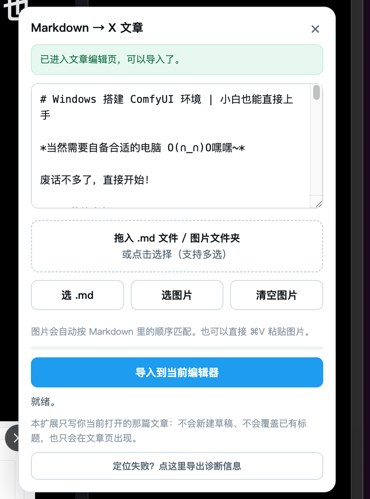

# md2xarticle

**把 Markdown 粘进 X（Twitter）文章编辑器** —— 自动转成 X 富文本、自动上传图片，不用手动排版、不用一张张传图。

> A Chrome extension (Manifest V3) that turns Markdown into an X/Twitter Article — rich text **and** images written straight into the editor you already have open.

**核心特点：不新建草稿、不改 URL、不覆盖已有标题 —— 只写你当前打开的那篇文章。**

---

文章页面右下角会有`导入 Markdown 按钮`，点击会唤起如下窗口。

## 安装（暂未上架，手动加载）

Chrome / Edge / Arc / Brave 等 Chromium 内核浏览器通用，**不需要构建，零依赖**。

1. 把本仓库拉到本地（`git clone`，或直接下载 ZIP 解压）
2. 打开扩展管理页：
   - Chrome → `chrome://extensions`
   - Edge → `edge://extensions`
   - Arc → `arc://extensions`
3. 打开右上角的 **开发者模式**
4. 点 **加载已解压的扩展程序**，选中本仓库根目录（就是含 `manifest.json` 的那一层）
5. 建议点工具栏的拼图图标 → 把扩展「固定」出来，方便看状态

环境要求：**Chromium 111+**（用到了 MV3 的 `world: "MAIN"` content script）。

> 因为尚未上架，浏览器启动时可能提示「请停用开发者模式扩展程序」，点忽略/关闭即可，不影响使用。

---

## 使用

### 四步

1. **打开文章页**：`x.com/compose/articles`
   > 面板**只在这个页面出现**。首页、时间线、消息、探索页都不会有按钮。
2. **手动新建一篇文章**（点页面上的「Write / 新建文章」），进到编辑页、能看到**标题框 + 正文输入区**。
   打开一篇已有草稿也行。
3. **点右下角白色「↑ 导入 Markdown」按钮**，把 Markdown 粘进去。
4. **点「导入到当前编辑器」**。进度条走完即完成，X 会自动保存。

**支持相对路径图片引用和外链自动下载上传**

### 面板顶部的状态提示

提示条会跟着当前页面变色，避免你在没有编辑区的地方白点：

| 状态                     | 提示                                                    |
| ------------------------ | ------------------------------------------------------- |
| 还没进编辑页             | 🔵 蓝色：先在 X 里**手动新建一篇文章**，进到编辑页再导入 |
| 在列表页、确认没有编辑区 | 🔴 红色：这里没有编辑区，请先新建一篇                    |
| 已在编辑页               | 🟢 绿色：可以导入了                                      |

### 怎么把 Markdown 给进去

| 方式     | 操作                                                          |
| -------- | ------------------------------------------------------------- |
| 粘贴     | 直接在面板的文本框里 `⌘V` / `Ctrl+V`                          |
| 拖文件   | 把 `.md` 拖进面板                                             |
| 选文件   | 点「选 .md」                                                  |
| 拖文件夹 | 把整个文章文件夹（`.md` + `images/`）一起拖进来，图片自动入队 |

### 图片怎么进

| 来源        | 怎么做                                                                                  |
| ----------- | --------------------------------------------------------------------------------------- |
| 本地文件    | 把图片（或整个文件夹）拖进面板 / 点「选图片」。按**文件名**与 Markdown 里的路径自动配对 |
| 剪贴板      | 截图或复制图片后，在面板里直接 `⌘V`                                                     |
| 远程 URL    | Markdown 里写 `https://...` 的图会自动抓取（受图床防盗链限制，失败的会在面板里列出）    |
| 内联 base64 | `data:image/...` 直接支持                                                               |

图片会按 Markdown 里的顺序落到**对应位置**，不是全堆在末尾；格式与体积会被自动整理成 X 能接收的样子。

### 想中途停下

导入期间主按钮置灰、旁边出现 **「中断」** 按钮。点一下立刻停在当前位置：已写入的正文和已插好的图片**保留**，没插成功的占位段会被**清理干净**。想继续就改好 Markdown 再点一次。

---

## Markdown 支持情况

| 语法                    | 结果                                                    |
| ----------------------- | ------------------------------------------------------- |
| `#` ~ `######` 标题     | ✅ 但 X 只有两级：`#` → H1，`##` 及以下 → H2             |
| **加粗**、*斜体*        | ✅ 保真（含中文强调的边界情况）                          |
| [链接](url)             | ✅ 保真，**标题里的链接也能正确解析**                    |
| 有序 / 无序列表         | ✅                                                       |
| `>` 引用                | ✅                                                       |
| 图片 ``      | ✅ 变成真实上传的图片                                    |
| 代码块                  | ⚠️ 保留结构，但 X 当普通段落处理，等宽字体可能丢         |
| 表格                    | ⚠️ 降级成「用 ｜ 分隔的段落」（X 文章本身不支持表格）    |
| 分割线 `---`            | ⚠️ 降级成一行 `———` 文字                                 |
| YAML front matter       | ✅ 其中的 `title:` 会用作文章标题                        |
| 双链图片 `![[img.png]]` | ✅ 自动转成标准图片语法                                  |

**文章标题**：优先取 front matter 的 `title`，否则取正文第一个 `# H1`（并从正文里移除，避免重复）。

---

## 它解决什么问题

X 的文章编辑器只吃富文本。写一篇长文要先在本地排版、再逐张传图、再对齐位置，很费时间。

常见的现成方案有个通病：**它们要求你先让它自己「新建草稿」**。实现上往往只认 URL 里的 `/compose/articles/edit/<纯数字>`，一旦不匹配（X 改了 id 格式、或你人在列表页），它就跑去点「新建文章」按钮 —— 而你人在编辑页根本没有那个按钮，于是几十秒后超时报错。

本扩展反过来：**你已经手动把文章建好了，它只负责往里写。**

|                | 常见做法                           | 本扩展                                    |
| -------------- | ---------------------------------- | ----------------------------------------- |
| 草稿           | 插件自己点「新建文章」，超时即失败 | **不碰**，直接写你当前打开的文章          |
| 入口           | 只能选文件夹                       | 粘文本 / 拖 `.md` / 选文件 / 拖整个文件夹 |
| 文章标题       | 无条件覆盖                         | **只在标题框为空时**填，绝不覆盖          |
| 编辑器已有内容 | 可能冲突                           | 自动**追加**到末尾，不动原文              |
| 面板出现时机   | 常驻所有 x.com 页面                | **只在文章页**出现                        |
| 想停下来       | 没有办法                           | **随时中断**，已写入的内容保留            |
| 出问题         | 一句报错                           | 内置**诊断按钮**，一键导出页面结构        |

---

## 更多

权限说明、工作原理、常见问题、开发与自测、目录结构、Roadmap —— 都在 **[docs/DETAILS.md](docs/DETAILS.md)**。

---

## License

[MIT](./LICENSE) © sugar
