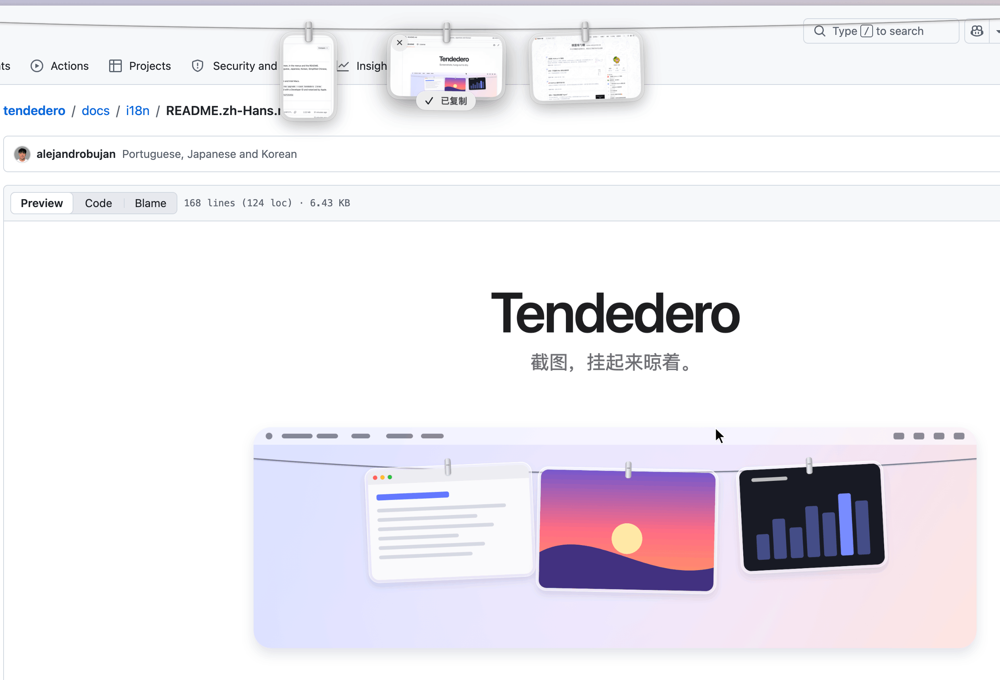
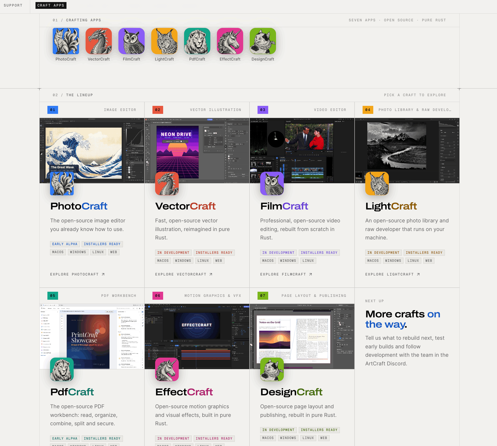
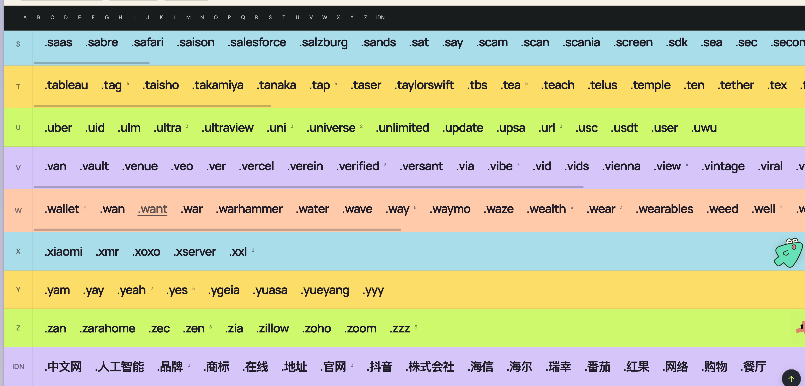
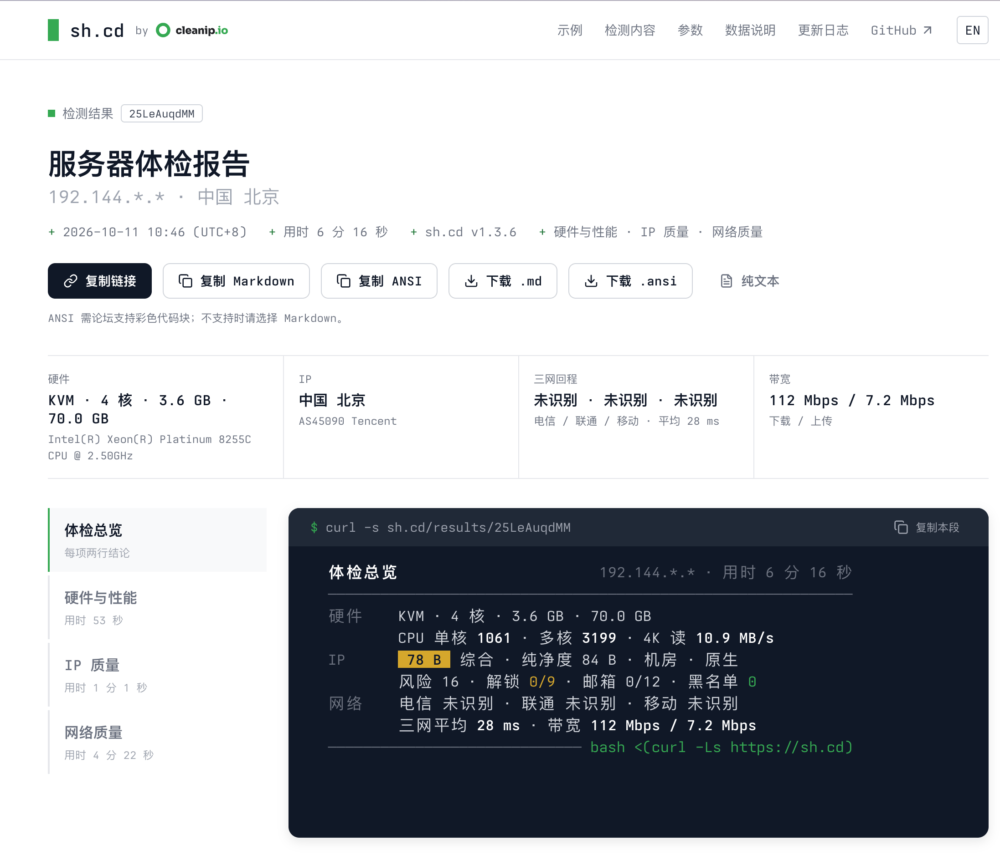

# 视野修炼第136期 | 前端小恐龙"Deno"被收购

欢迎来到第 136 期的【视野修炼 - 技术周刊】，下面是本期的精选内容简介

[[toc]]

下面开始本期内容的介绍**ღ( ´･ᴗ･` )比心**。

## 🔥强烈推荐
### [1. Deno 加入Cloudflare](https://deno.com/blog/cloudflare)


继Bun,VoidZero,Tailwind CSS后，Deno也被收购了。

你觉得下一个会是哪个大前端系的项目？


### [2. 将你的截图晾起来](https://github.com/alejandrobujan/tendedero)

非常 Cool 的一个截图管理工具。



作者提供的是Mac 版本，社区有小伙伴做了 Windows 版本（没翻到开源，等找到了评论补充）。

### [3. 开源版 Adobe 全家桶](https://getartcraft.com/apps)

有人利用 AI 逆向 Photoshop 然后重写出了开源版的 `PhotoCraft`，同时支持AI直接调用完成相关资源处理。



Adobe 的7个主力产品，都进行了重写开源。

收藏了！


## 🔧开源工具&技术资讯
### [4. 一整轮全新的顶级域名](https://gtlds.fyi/)

ICANN 已经公布了一整轮全新的顶级域名



中文几个的还挺有意思！

`.中文网`,`.人工智能`, `.品牌`,`.抖音`,`.番茄`,`.红果`

### [5. 服务器体检](https://github.com/CleanIP/sh.cd)
一行脚本，即可查看服务器状态。

自动检查硬件、性能、IP 质量、网络质量等指标，非常详细。
```sh
bash <(curl -Ls https://sh.cd)
```
下面是笔者的机器体检截图。



报告分享：https://sh.cd/results/25LeAuqdMM

## ⭐️强力推荐关注

> 周刊部分内容来源如下渠道，推荐大家关注。

- [阮一峰: 科技爱好者周刊](https://www.ruanyifeng.com/blog/archives.html) - 记录每周值得分享的科技内容，周五发布
- [frontendfoc](https://frontendfoc.us/issues) - 🚀 Frontend **Focus**
- [JavaScript Weekly](https://javascriptweekly.com/issues) - A newsletter of JavaScript articles, news and cool projects
- [nodejs Weekly](https://nodeweekly.com/issues) - A free, once–weekly e-mail round-up of Node.js news and articles.

---

## 📎 附：语法覆盖检查（测试用）

下面这段不是周刊原文，放这里是为了顺手验证几种语法的实际处理效果 —— 测完删掉即可。

| 语法 | 预期效果 |
| --- | --- |
| 表格 | 降级成「用 ｜ 分隔的段落」 |
| 分割线 | 降级成一行 `———` |
| 行内代码 | 保留 |

- [x] 标题抽取（H1 / front matter title）
- [x] 图片插入（5 张）
- [ ] 表格保真（X 文章本身不支持）

1. 有序列表第一项
2. 有序列表第二项
